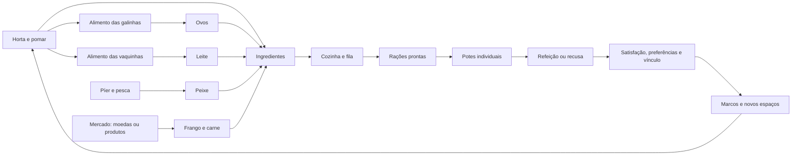

# Plano de expansão do Quintal: espaços, cuidados e produção

Data: 06/10/2026.
Estado: primeira implementação local em validação em 06/10/2026.
Documento canônico: repositório Gatalogo, pasta docs. A cópia na API deve permanecer idêntica.

## 1. Objetivo e status das decisões

O Quintal se torna um espaço vivo de cuidado e produção. O ciclo é plantar ou pescar, obter ingredientes, preparar rações, alimentar os gatos, descobrir suas preferências e desenvolver vínculo. Galinhas e vaquinhas acrescentam ingredientes e atividades ao cenário.

Descobrir gatos e completar registros continua sendo a atividade principal do app. O Quintal complementa esse progresso; produção repetitiva não deve superar a catalogação legítima em XP ou dominar os rankings.

**Acordado** identifica decisões aceitas na conversa. **Proposta de balanceamento** identifica regras complementares, preços, prazos, quantidades e probabilidades que precisam de revisão e testes. Os números deste documento orientam o catálogo versionado desta implementação e continuam sendo valores iniciais de balanceamento.

## 2. Decisões acordadas

1. O nome público é Quintal.
2. Cada gato tem um pote de comida e um de água, identificados por cor, nome e símbolo. Alimentação é acionada pelo pote, não pelo gato.
3. Colocar um gato exige colocar os dois potes no mesmo fluxo. Retirar o gato devolve os potes associados ao inventário automaticamente.
4. A água tem cuidado simples: abastecer cada pote uma vez por dia.
5. O inventário possui abas Decorações, Rações e Ingredientes.
6. Preferências são individuais por gato e receita: Odeia, Não é fã, Aceita, Normal, Gosta, Gosta muito e Favorita.
7. Odeia implica recusa. A porção servida é perdida, incluindo os ingredientes gastos anteriormente na fabricação.
8. Não é fã, Aceita e Normal podem evoluir ou regredir ao estado vizinho. A partir de Gosta não há regressão; avanços são raros.
9. A expansão da horta depende da expansão do Quintal. A expansão 2 do Quintal pode liberar a expansão 2 da horta.
10. Pesca possui minigame e progressão de varas; equipamentos podem melhorar facilidade e rendimento.
11. Píer, horta e instalações aproveitam composições dos modelos existentes.
12. Galinhas e vaquinhas são residentes, distintas dos visitantes decorativos e entregadores.
13. **Frango e carne são obtidos por encomendas no mercado, com moedas ou produtos. Galinhas e vaquinhas residentes permanecem no Quintal, produzindo ovos e leite. Não há abate, consumo ou desaparecimento desses animais para obter carne.**

## 3. Organização espacial

| Espaço | Função | Elementos |
| --- | --- | --- |
| Quintal central | Gatos, cuidados e decoração | Potes, descanso, brinquedos e caminhos |
| Horta | Plantio e colheita | Canteiros expansíveis, cultivos e rega |
| Cozinha | Preparo de rações | Bancada, produção ativa e fila |
| Píer | Pesca | Estrutura reparável, acesso e equipamento |
| Galinheiro | Galinhas e ovos | Abrigo, cercadinho, ninhos, alimento e água |
| Pasto | Vaquinhas e leite | Abrigo, circulação, alimento e água |
| Pomar | Frutas, em etapa posterior | Árvores compostas e colheita |
| Mercado | Encomendas de proteínas | Bancada ou acesso contextual, pedidos e entregas |

Horta, galinheiro e pasto ficam ao lado do Quintal central, ligados por caminhos. Não consomem silenciosamente células já liberadas para os gatos. A expansão mostra o perímetro antes da compra.

Áreas produtivas têm instalações fixas e alguns pontos de decoração, sem exigir um editor completo para cada construção. A câmera alcança os espaços desbloqueados; seus limites crescem de maneira controlada. Espaços bloqueados podem aparecer como composições pequenas de antecipação. A decoração externa é remanejada quando a área é aberta.

### Modelos verificados e trabalho de composição

| Composição | Assets/base | Trabalho necessário |
| --- | --- | --- |
| Píer pronto | structure-platform-dock | Escala, acesso e ponto de pesca |
| Píer quebrado | structure-platform-dock e platform-planks | Remover partes do piso, inclinar peças e criar buracos visíveis |
| Galinheiro | structure-fence, structure-fence-sides, plataforma e telhado | Abrigo legível, entrada, ninhos e cercado |
| Milho/trigo | crops_cornStageA–D e crops_wheatStageA–B | Estágios associados ao relógio da API |
| Folhagens | crops_leafsStageA–B | Uso nos canteiros e composições intermediárias |
| Colheitas | crop_carrot, crop_turnip, crop_pumpkin, crop_melon | Composição sobre a terra |
| Canteiros | crops_dirtSingle, crops_dirtRow, crops_dirtDoubleRow e conexões | Encaixe e leitura de plantio |
| Galinhas | animal-chick | Criar variante adulta branca/marrom, com proporções e crista; não foi encontrado um modelo adulto específico |
| Vaquinhas | animal-cow | Rotinas, pontos de uso e escala |
| Peixe | animal-fish e fish do Food Kit | Separar fauna decorativa do ingrediente |
| Ovos | egg e variantes do Food Kit | Composição dos ninhos |
| Cozinha | pot, pot-lid, pot-stew e utensílios | Bancada e estados de produção |
| Pomar | Árvores existentes e frutas do Food Kit | Compor fruteiras; não foram identificadas árvores frutíferas prontas |

Referência: build/galeria-visual/modelos/index.html, com os caminhos na branch feature/etapa9-3d-metagame. As prévias mostram as cores originais; a integração deve aplicar a paleta compartilhada do Quintal.

## 4. Progressão, construção e reparos

O código atual tem expansão interna 0 a 3 e capacidade de 3 a 6 gatos. Preservar essa correspondência. Os níveis da horta são independentes, sujeitos a requisitos do Quintal.

**Proposta de balanceamento inicial:**

| Marco | Requisito proposto | Benefício | Custo base | Prazo |
| --- | --- | --- | ---: | --- |
| Horta 1 | Missão inicial de cuidado | 4 canteiros; milho, trigo e cenoura | Grátis | Imediato |
| Cozinha 1 | Primeira colheita | Uma produção ativa e uma em espera | 40 moedas | 10 min |
| Reparo do píer e acesso | Quintal expansão 1 e primeira ração preparada | Pesca e vara básica | 80 moedas | 30 min |
| Mercado | Cozinha 1 | Encomendas de frango | Grátis | Imediato |
| Galinheiro 1 | Quintal expansão 1, milho e cozinha | 2 galinhas | 100 moedas | 1 h |
| Horta 2 | Quintal expansão 2 e 10 colheitas | 8 canteiros; nabo e abóbora | 120 moedas | 1 h |
| Cozinha 2 | Quintal expansão 2 e 10 preparos | Uma produção ativa e 3 em espera | 140 moedas | 1 h |
| Pasto 1 | Quintal expansão 2 e galinheiro ativo | 1 vaquinha; receitas com leite | 180 moedas | 2 h |
| Encomendas de carne | Quintal expansão 2 | Nova proteína no mercado | Sem obra | Imediato |
| Vara melhorada | 10 capturas válidas | Captura mais fácil | 100 moedas | Imediato |
| Galinheiro 2 | Quintal expansão 3 e 20 ovos coletados | 4 galinhas | 200 moedas | 2 h |
| Horta 3 | Quintal expansão 3 e 30 colheitas | 12 canteiros; melão | 220 moedas | 2 h |
| Pasto 2 | Quintal expansão 3 e 10 coletas de leite | 2 vaquinhas | 260 moedas | 4 h |
| Vara avançada | Quintal expansão 3 e 30 capturas | Facilidade e chance de peixe extra | 240 moedas | Imediato |
| Pomar 1 | Horta 3; etapa posterior | 2 árvores frutíferas | 280 moedas | 4 h |

Não criar madeira, ferramentas ou outra moeda obrigatória apenas para as obras nesta versão. Custos precisam ser ajustados conforme a economia real.

Estados: bloqueada → liberada → confirmação → em construção → pronta para concluir → ativa. Mostrar custo, prazo e benefícios antes de iniciar. Debitar uma vez ao início; fechar o app não reinicia a obra. Concluir mostra a transformação e os novos usos.

Proposta: uma obra por instalação; instalações diferentes podem ter obras simultâneas. Voltar da confirmação não cobra nada. Cancelamento após início fica fora da primeira versão.

A loja gratuita de testes pode zerar custos monetários, preservando preços base. Não zerar automaticamente tempo e requisitos. Aceleração de QA exige configuração própria, explícita, sem alterar o relógio do aparelho.

## 5. Horta e pomar

Um canteiro contém uma cultura por vez. Estados: vazio, plantado, crescendo, pronto e colhido/vazio. Plantas prontas aguardam a coleta; não morrem nem apodrecem por ausência.

Proposta: sementes básicas gratuitas, como escolha de plantio; não criar uma quarta aba de inventário.

| Cultivo | Liberação | Crescimento base | Colheita por canteiro | Visual |
| --- | --- | --- | ---: | --- |
| Milho | Horta 1 | 30 min | 2 unidades | 4 estágios |
| Trigo | Horta 1 | 45 min | 3 unidades | 2 estágios |
| Cenoura | Horta 1 | 1 h | 2 unidades | Broto composto e cenoura madura |
| Nabo | Horta 2 | 1 h 30 min | 3 unidades | Folhagem e nabo |
| Abóbora | Horta 2 | 2 h | 2 unidades | Folhagem e fruto |
| Melão | Horta 3 | 4 h | 3 unidades | Folhagem e fruto |

Rega proposta: opcional, uma vez por plantio; reduz 15% do tempo restante. O cultivo cresce sem ela e não exige várias visitas por dia. Repetir rega não acelera novamente nem gera progresso.

Colher entrega o lote inteiro e libera o canteiro. Novo ciclo exige novo plantio. Não há colheita automática infinita.

Pomar posterior: macieira e pereira como composições a validar; 3 frutas por árvore a cada 8 h. Um lote pronto permanece; próximo ciclo inicia após coleta. Essa diferença em relação ao replantio da horta deve ser explícita.

## 6. Cozinha e rações

Fluxo: selecionar receita → conferir estoque, rendimento e prazo → confirmar → reservar ingredientes → preparar → concluir → coletar porções.

Receita é uma fórmula identificada. Não criar combinações livres ilimitadas nesta etapa. Preferência pertence à fórmula; variações cosméticas não reiniciam sua descoberta.

**Receitas fictícias do jogo e valores propostos:**

| Receita | Ingredientes por lote | Preparo | Porções | Satisfação base | Liberação |
| --- | --- | --- | ---: | ---: | --- |
| Ração básica | Oferta gratuita limitada | Imediato | Uma por gato/dia | 8 | Início |
| Mistura da horta | 2 trigo + 1 cenoura | 10 min | 3 | 12 | Cozinha 1 |
| Mistura com peixe | 1 peixe + 2 trigo | 20 min | 3 | 16 | Píer |
| Mistura com ovo | 1 ovo + 1 milho + 1 trigo | 25 min | 3 | 18 | Galinheiro |
| Mistura com frango | 1 frango + 2 trigo + 1 cenoura | 40 min | 4 | 20 | Mercado |
| Mistura com carne | 1 carne + 2 trigo + 1 abóbora | 1 h | 4 | 22 | Mercado e Horta 2 |
| Mistura cremosa | 1 leite + 1 ovo + 2 trigo | 45 min | 4 | 20 | Pasto |
| Mistura especial | 1 peixe + 1 frango + 1 abóbora | 2 h | 6 | 24 | Cozinha 2 |

Essas fórmulas não são orientações nutricionais para animais reais. Satisfação e saciedade são efeitos distintos; uma favorita não elimina toda a necessidade de alimentação futura.

Ingredientes da fila são reservados na confirmação. Cancelar uma tarefa em espera devolve a reserva. Tarefa já preparando não pode ser cancelada inicialmente.

A próxima tarefa inicia automaticamente no horário de conclusão da anterior, mesmo offline, com ingredientes previamente reservados. Produtos prontos ficam associados a cada tarefa até coleta, sem bloquear a fila. Não cobrar moedas extras por preparo nesta proposta.

## 7. Gatos, potes e alimentação

### 7.1. Colocar e retirar

Adicionar um gato é uma operação atômica: selecionar gato → posicionar comida → posicionar água → validar caminhos → confirmar o conjunto. Cancelar não deixa vínculos incompletos.

Proposta: um par inicial gratuito por gato. Potes coloridos são personalização, não requisito pago. Nome e símbolo acompanham a cor.

Mover potes valida o acesso. Guardar um pote isolado exige reposição no mesmo fluxo ou retirada do gato. Ao retirar, ambos voltam ao inventário; vínculo e preferências permanecem. Retirar/recolocar não reinicia fome.

Proposta: alimento ainda não consumido no pote retorna ao inventário quando o gato é retirado. Uma porção já recusada nunca retorna. Fechar durante refeição não duplica nem devolve algo consumido.

### 7.2. Comida e fome

“Pote de Mimi” apresenta receitas, quantidade, preferência conhecida, efeito previsto e estado do gato. Proposta: capacidade inicial de 2 porções, melhorável para 4; uma receita por pote. Trocar comida ainda não servida devolve o estoque restante.

Proposta de ciclo: uma porção pode ser consumida a cada 12 h quando houver necessidade e alimento. A API resolve refeições offline, uma a uma, limitadas pelo estoque. Reações ficam no resumo de retorno, sem pagar novamente.

Fome muda gradualmente. Não há morte, doença, perda de gatos ou perda de vínculo por ausência. A apresentação tem um piso acolhedor, sem sofrimento visual.

A ração básica mantém cuidados possíveis sem ingredientes. O abastecimento de receitas especiais continua sendo uma escolha vantajosa.

### 7.3. Água

Uma recarga por dia do calendário do jogo. Proposta: recarga mantém disponibilidade por 24 h; a mudança de dia permite abastecer novamente sem secar instantaneamente um pote recém-abastecido.

Não há qualidade, preferências, receitas ou ingrediente para água. Mostrar dono, estado e última recarga. Cada gole não concede XP. Abastecimento coletivo pode ser liberado depois de ensinar o fluxo individual.

## 8. Preferências e consequências

Ordem: **Odeia → Não é fã → Aceita → Normal → Gosta → Gosta muito → Favorita**.

| Estado | Come? | Multiplicador proposto de satisfação | Evolução |
| --- | --- | ---: | --- |
| Odeia | Não | 0 | Terminal nessa receita |
| Não é fã | Sim | 0,25 | Pode odiar ou aceitar |
| Aceita | Sim | 0,65 | Pode regredir ou ficar normal |
| Normal | Sim | 1,00 | Pode aceitar ou gostar |
| Gosta | Sim | 1,20 | Pode avançar; não regride |
| Gosta muito | Sim | 1,40 | Pode virar favorita; não regride |
| Favorita | Sim | 1,65 | Máximo positivo |

Proposta inicial: 15% Não é fã, 25% Aceita e 60% Normal. Primeira exposição não começa em Odeia. O estado inicial é persistido, mesmo desconhecido na interface, sem novo sorteio ao reabrir.

Probabilidades propostas por avaliação elegível:

- Não é fã: 7% para Aceita; risco de Odeia de 3%, 6% e 10% na primeira, segunda e terceira insistência consecutiva, mantendo 10% depois. Outros resultados não mudam o estado.
- Aceita: 12% para Normal e 8% para Não é fã.
- Normal: 10% para Gosta e 8% para Aceita.
- Gosta: 5% para Gosta muito.
- Gosta muito: 2% para Favorita.
- Favorita e Odeia: sem novo sorteio.

Proposta: uma avaliação por gato/receita a cada 24 h, apenas depois de refeição consumida. Outra receita interrompe a insistência, sem apagar a preferência. Repetir porções não permite farmar evolução.

Usar a preferência anterior para a satisfação da refeição; a mudança vale na próxima. Se uma refeição consumida transforma Não é fã em Odeia, essa primeira porção já foi comida; recusas ocorrem nas seguintes.

Quando Odeia, a porção servida é perdida, sem saciedade nem progresso de refeição bem-sucedida. Mostrar motivo e perda. Servir uma receita já conhecida como odiada exige confirmação contextual.

Proposta de exceção: ração básica sempre aceita, sem evolução ou recusa, garantindo a continuidade dos cuidados.

Não apagar gostos permanentes para forçar variedade. Novas receitas oferecem outras escolhas de rendimento, prazo e disponibilidade. Simular probabilidades para evitar que a conquista de uma favorita exija anos.

## 9. Satisfação, vínculo e brincar

Satisfação individual reúne alimentação, diversão e conforto; água disponível participa dos cuidados atendidos. A interface explica a causa e oferece ações úteis.

Diversão vem da brincadeira; conforto exige móveis acessíveis. Bônus temporários decaem gradualmente. Conforto não cresce ilimitadamente pela repetição de móveis.

Varinha inicial: 15–25 s de interação, com acompanhamento, saltos e descanso. Oferecer controle simples por toque. A API reconhece uma sessão concluída; abrir ou esperar sozinho não gera prêmio.

Vínculo proposto por gato/dia: refeição válida +2, carinho +1 e brincadeira +2; primeira refeição favorita válida pode dar +1 adicional. Repetições continuam possíveis sem pontos ilimitados.

Migrar afinidade sem reset. Marcos propostos: 20, 50, 100 e 200 pontos, com reações, atividades, decoração e reconhecimento disponíveis. Não anunciar animações ou itens exclusivos que ainda não existam.

## 10. Galinheiro e ovos

Galinhas nomeáveis saem do abrigo, ciscam, procuram alimento, descansam e voltam. Compartilham comedouro e água; potes individuais obrigatórios são dos gatos.

| Recurso/atividade | Proposta |
| --- | --- |
| Comida | 1 milho por galinha sustenta 24 h de produção |
| Água | Recarga diária coletiva, disponibilidade por 24 h |
| Ovo | 1 por galinha adulta a cada 6 h com cuidados atendidos |
| Ninho | Até 2 ovos por galinha; cheio pausa produção |
| Galinheiro 1/2 | 2/4 residentes |
| Incubação posterior | 24 h |
| Crescimento de pintinho | 24 h |

Falta de cuidado pausa a produção futura; ovos prontos permanecem. Retomar o trabalho restante ao abastecer, sem pagar ovos por períodos sem alimento/água.

Incubação posterior exige vaga reservada e “ovo para incubar”, distinto do ingrediente culinário. Não transformar todo ovo em pintinho. Incubação concluída aguarda o jogador.

Proposta de início: construção inclui acesso a duas galinhas adultas, dispensando incubação obrigatória. Isso precisa de aprovação e de variantes adultas prontas.

Não há reprodução obrigatória, doenças ou perda de residentes por ausência. Residentes não produzem ingrediente frango.

## 11. Pasto e leite

Vaquinhas têm abrigo, circulação, alimento e água próprios. Não atravessam cercas, rio, galinheiro ou a área editável dos gatos.

| Recurso/atividade | Proposta |
| --- | --- |
| Comida | 2 trigo + 1 milho por vaca sustentam 24 h |
| Água | Uma recarga coletiva diária, disponibilidade por 24 h |
| Leite | 1 unidade por vaca a cada 8 h com cuidados atendidos |
| Depósito | Até 2 unidades por vaca; cheio pausa produção |
| Pasto 1/2 | 1/2 vaquinhas |
| Bezerro, etapa posterior | Crescimento de 48 h e modelo adaptado |

Coleta transfere o lote pronto; a animação não produz o recurso por si só. Faltar cuidado pausa o trabalho restante, sem apagar leite pronto. Mover decoração ou residente não reinicia produção. Vaquinhas não são consumidas para obter carne.

## 12. Mercado, frango e carne

**Decisão aceita:** encomendas, com moedas ou produtos, mantendo os residentes no Quintal.

| Encomenda | Pagamento alternativo proposto | Prazo | Entrega |
| --- | --- | --- | --- |
| Frango | 2 milho + 1 trigo, ou 12 moedas | 1 h | 2 unidades |
| Carne | 2 leite + 2 trigo, ou 20 moedas | 2 h | 2 unidades |

Escolher uma forma de pagamento; não cobrar as duas. A rota por moedas permite adquirir carne mesmo sem leite disponível, respeitando o desbloqueio.

Estados: disponível → pedido confirmado → em preparação/entrega → pronto → coletado. Debitar/reservar uma vez na confirmação. Produto pronto permanece até coleta.

Proposta inicial: uma encomenda ativa por fornecedor; frango e carne compartilham essa vaga. Pedido aguardando confirmação pode ser abandonado sem custo. Pedido iniciado não tem cancelamento nessa fase.

A descrição deve ser “Encomendar frango/carne”, sem sugerir que o animal residente desapareceu. O prazo inclui preparo e transporte; não representa criação ou abate.

## 13. Pesca e equipamento

Proposta: uma única obra de reparar o píer e seu acesso. A ponte pode integrar essa composição, sem duas compras para abrir a mesma atividade.

Antes: tábuas faltando e interação de obra. Depois: piso completo e ponto seguro. Não permitir pescar sobre peças quebradas.

Minigame: segurar sobe a área de captura, soltar desce. Acompanhar o peixe preenche o progresso; sair reduz com tolerância. Alternativa simples por toque. Não exigir toques rápidos repetidos.

| Vara | Efeito proposto |
| --- | --- |
| Básica | 1 peixe por captura; área padrão |
| Melhorada | Área 25% maior e tolerância de erro maior |
| Avançada | Mesma facilidade; 20% de chance de 1 peixe extra |

Tempos propostos: mordida em 3–8 s; disputa em 15–30 s. Perder não consome vara nem ingrediente. Iscas não são obrigatórias.

Proposta de limite: 12 capturas com ingrediente por dia; depois, prática sem prêmio, claramente identificada. Revisar esse teto conforme receitas e número de gatos.

Sessão possui ID e validação da API. Resultado extra é sorteado e persistido uma vez. Peixe decorativo não é removido do rio a cada captura.

## 14. Inventário e capacidades

| Aba | Conteúdo |
| --- | --- |
| Decorações | Móveis, potes, caminhos e objetos guardáveis; filtros por tipo/dono |
| Rações | Porções por receita, efeito, detalhes e preferências conhecidas |
| Ingredientes | Colheitas, frutas, ovos, leite, peixe, frango e carne |

Instalações fixas e residentes são geridos pelos espaços, não como itens guardáveis que possam duplicar produção.

Proposta: sem limite global de ingredientes no início. Capacidades locais de potes, ninhos e leite permanecem. Não perder colheita porque o inventário geral ficou cheio.

Cartões mostram quantidade real, reserva e usos. Acesso contextual: pote abre Rações para seu gato; cozinha destaca ingredientes necessários.

Não há apodrecimento nem validade nessa etapa. Perda acordada ocorre na recusa de porção; uso no preparo é consumo normal, não perda aleatória.

## 15. Relógio, ausência e recuperação

Instantes são persistidos em UTC. Calendário diário: America/Sao_Paulo, alinhado aos marcos. Corrigir a diferença atual dos cuidados que usam dia UTC, sem duplicar recompensas no dia da migração.

Exibir HH:MM:SS ou duração legível; pronto nunca mostra contador negativo. Relógio do aparelho não altera produção.

Ao retornar, calcular tarefas, filas, refeições e produção permitidas por estoque, capacidade e intervalos efetivamente atendidos. Não simular cada minuto nem conceder recursos por animação.

“Enquanto você esteve fora…” reúne novidades, permite pular e oferece atalhos. Ver o resumo não coleta nem paga novamente. Persistir quais celebrações já foram vistas.

Ausência não apaga vínculo, favoritas, residentes ou produtos prontos. Offline mostra último estado e previsão identificada; operações que consomem ou concedem recursos exigem confirmação da API.

## 16. Missões, reconhecimento e visitantes

Reutilizar o sistema unificado de marcos; não criar XP agrícola ou outra moeda.

Eventos sugeridos: conjunto do gato colocado, água abastecida, refeição consumida/recusada, brincadeira concluída, cultivo plantado/regado/colhido, receita concluída, peixe capturado, ovos/leite coletados, encomenda coletada, instalação concluída, preferência alterada e marco de vínculo.

Separar ação, quantidade e origem. Colher 3 trigo representa 1 colheita ou 3 ingredientes conforme a missão. Conclusão e coleta da mesma tarefa não pagam duas vezes.

- Iniciais únicas: colocar potes, água, primeira colheita, preparo, refeição, reparo e captura.
- Diárias: manter três objetivos contextuais ao que já foi desbloqueado, sem exigir todos os sistemas diariamente.
- Semanais: atividades mais longas e em dias diferentes; segunda a domingo.
- Conquistas: favoritas, vínculos, instalações e produção significativa, com medalhas permanentes.
- Desafios: temporadas futuras; não inventar uma ativa.

Priorizar ingredientes como recompensa da produção; XP e moedas vêm de marcos limitados. Gatos catalogados não incluem galinhas, vacas ou peixes. Rankings preservam as categorias discutidas.

Satisfação e composição continuam influenciando visitantes. Presente diário garantido por uma pequena sequência de cuidados é proposta complementar; extras seguem chances/limites persistidos. Visitantes decorativos não dão saldo. Baús prontos aguardam coleta.

## 17. Arquitetura, consistência e migração

Separar modelos técnicos de instalação/obra, canteiro, tarefa, estoque/reserva, residente, cuidado, pote vinculado, preferência, pesca e recompensa.

Entidades possíveis: QuintalFacility, ProductionTask, ResourceBalance, ResourceTransaction, CropPlot, ResidentAnimal, CatBowlAssignment, CatFoodPreference e FishingSession. Esquema é proposta técnica; não acumular todo histórico crescente em um único JSON da carteira.

Uma projeção compartilhada deve informar revisão, horário do servidor, calendário, instalações, tarefas, estoque, gatos/potes e produção. App inteiro aplica a mesma revisão.

Operações: iniciar/concluir obra; plantar/regar/colher; preparar/coletar/cancelar fila; encomendar/coletar; abastecer; colocar/retirar conjunto; iniciar/concluir pesca.

Locks, transações e idempotência protegem reserva, consumo e crédito. Repetição retorna resultado persistido. RNG de preferências, extras e presentes não muda ao reabrir.

Não aceitar apenas “pesca terminou” como prova. Validar sessão, regras, duração e condições do resultado. Documentar limitações contra cliente adulterado, sem prometer proteção perfeita.

Preservar afinidade, carteira, conquistas, estoque e desbloqueios. Gatos existentes recebem migração assistida de potes, sem sumir ou pagar retroativamente. Preservar contadores para impedir uso de remoção como reset.

Rotas técnicas legadas /app/habitat podem permanecer compatíveis; nomes públicos são Quintal.

Componentes reutilizáveis: painel de instalação, cartão de tarefa, contador, receita, lote, pote, preferência, confirmação e recompensa. Reutilizar papel/verde, ilustrações e paleta existentes.

## 18. Direção visual e validação

Ninhos dentro do abrigo, plantas sobre terra, água/ração acessíveis, peixes dentro do rio, cercas encaixadas e animais seguindo acessos válidos.

Sombras e profundidade usam bases reais. Cercas não atravessam objetos/animais à frente. Pedras não ocupam água; árvores não bloqueiam rotas. Variedade não deve prejudicar leitura.

Estados claros: obra, crescendo, preparando, pronto, falta de abastecimento e recusa. Cor não é o único indicador. Variante adulta do pintinho exige revisar silhueta, proporções e animações.

Após cada entrega visual, atualizar galeria permanente de telas e movimentos. A biblioteca de modelos permanece disponível; não importar automaticamente todos os assets para o app.

## 19. Entregas e aceite

1. Estado, migração, potes individuais e três abas do inventário.
2. Horta, cozinha, reservas, filas e receitas iniciais.
3. Preferências, satisfação/vínculo e brincadeira.
4. Píer, minigame e varas.
5. Galinheiro, variantes adultas e ovos.
6. Pasto, leite e encomendas de proteínas.
7. Expansões, pomar posterior, marcos e balanceamento integrado.

Critérios:

- Dados reais da API, sem valores inventados na interface.
- Repetição, concorrência, reconexão e troca de conta não duplicam nada.
- Fechar durante ação recupera estado consistente.
- UTC, calendário local e migração testados.
- Produção offline respeita reservas, alimento, água, capacidade e vagas.
- Mover/retirar não reinicia relógios ou preferências.
- Recusa perde porção, não reduz fome e não premia refeição.
- Ração básica e água mantêm cuidados acessíveis.
- Simular 3 e 6 gatos com 1–2 sessões diárias; ajustar rendimentos e limites.
- Simular prazo de favoritas e probabilidades de rejeição.
- Verificar câmera, caminhos, colisão, escala, profundidade e animação.
- Atualizar galeria e documentação dos contratos.

## 20. Pontos ainda sujeitos a aprovação

- Todos os preços, prazos, rendimentos, receitas e probabilidades propostos.
- Capacidade dos potes e limite de pesca.
- Oferta inicial de residentes e implantação posterior da incubação.
- Composição final das fruteiras e galinhas adultas.
- Ponte separada ou parte da mesma obra do píer.
- Catálogo real dos prêmios de vínculo e itens raros.

A origem de frango/carne já foi definida: mercado; não permanece pendente.

Este documento orienta a implementação. Não autoriza reset de progresso, deploy remoto ou uso de uma conta real para simular produção. Nenhuma funcionalidade planejada deve ser apresentada como já implementada.

## 21. Mapa do ciclo e exemplo de retorno

Exemplo proposto de sessão, sem obrigação de seguir essa sequência:

1. O jogador volta após uma noite fora. A API informa cultivos prontos, lotes de cozinha concluídos, ovos/leite acumulados dentro das capacidades e encomendas entregues.
2. A apresentação destaca as novidades; ver não coleta. O jogador escolhe os atalhos que deseja usar.
3. Coleta recursos, prepara ou enfileira rações, planta novamente e abastece animais de produção.
4. Nos potes dos gatos, escolhe receitas com a preferência conhecida e abastece água. Pode brincar com um gato e fazer algumas capturas no píer.
5. Sai com tarefas em andamento e estoque nos potes. O app fechado não interrompe trabalho atendido por reservas, nem cria recursos sem limite.

Essa sessão deve ser confortável em poucos minutos. Coleta e abastecimento em grupo precisam reduzir repetição quando houver 6 gatos, 4 galinhas e 2 vaquinhas. O sistema não deve exigir uma sequência completa de horta, pesca, cozinha e todos os cuidados em cada login.

## 22. Revisão da interação e arte — 06/10/2026

Decisão da usuária: o inventário permanece como **bandeja inferior dentro do Quintal**, com abas Decorações, Rações e Ingredientes. Não usar uma página independente. As decorações mantêm seleção/arraste para posicionamento; rações mostram quantidades e preferências conhecidas; ingredientes mostram estoque e usos.

As ações rápidas usam ferramentas ilustradas junto ao objeto, sem cabeçalho largo e corpo de painel. Plantio, receitas e escolha de ração utilizam uma bandeja inferior horizontal; custos, bloqueios e ingredientes continuam visíveis antes da ação. Selecionar não coleta nem gasta. A API continua confirmando toda alteração de recursos.

Foram incorporados 34 PNGs fornecidos em `Downloads/Quintal`, em `assets/quintal/ui`, mantendo os modelos isométricos no cenário. Arquivos de ração sem receita correspondente não criam novos itens de catálogo. O brief de arte registra os complementos opcionais.

Terrenos abandonados usam construções quebradas e conjuntos de mato, pedras e madeira distribuídos pela área futura. Durante a obra o excesso é retirado; as peças preservam ordenação por profundidade. A câmera calcula os limites a partir da extensão projetada do cenário e do zoom, com regressão cobrindo as quatro extremidades.

Validação local: testes do Flutter exercitam ações, câmera, regras do mundo e capturas da página real em 390 × 844 e 320 × 568; os dados da galeria são projeções isoladas da API, sem editar a conta de testes. A aprovação estética final é da usuária. Validação integral com o banco local permanece separada: a última tentativa de conexão do Alembic foi recusada; `/health` sozinho não confirma acesso ao banco.

### Revisão dos espaços em 07/10/2026

A seleção de modelos utiliza o inventário categorizado da galeria, gerado da branch `feature/etapa9-3d-metagame` (commit `75e9b587bd756c203d549d433631d5624bb6ffba`), sem trocar a branch de trabalho.

- **Horta:** `crops_dirtDoubleRow`, `patch-sand` e bordas de `platform-planks` compõem canteiros com sulcos, terra contínua e versões seca/molhada. O espaço e os alvos de toque acompanham o novo espaçamento entre canteiros.
- **Acessos:** variantes reta, curva, ponta e entroncamento de `path_stone` substituem as faixas pintadas. A rede conecta os espaços e chega aos portões; teste cobre sua continuidade em todas as expansões.
- **Cercados:** `fence_gate` substitui a lacuna da entrada do galinheiro e do pasto, com escala, orientação e ordenação de profundidade compartilhadas com a cerca.
- **Abandono:** cercas caídas, madeira empilhada, pedras e mato formam grupos no terreno. As ruínas não utilizam mais uma estrutura com telhado inteiro embaixo de outro telhado desabado.
- **Loja:** os ícones ilustrados aparecem na expansão e na categoria Produção, que leva ao espaço real no Quintal. Compras e obras continuam sendo confirmadas no objeto, com preços/requisitos fornecidos pela API. Não foram criadas receitas ou recompensas por existir uma nova imagem.

As capturas de validação incluem horta, cercados, ruínas, bandeja de inventário e a categoria de produção da loja. A galeria usa fixtures isoladas; o app continua exibindo o estado real da conta.

### Estados de produção e revisão dos residentes — 07/10/2026

- Mercado: a ação Moedas reutiliza a moeda dourada do Gatalogo; Produtos combina os ingredientes ilustrados com setas de troca. Custos e estoques continuam vindo da API.
- Terrenos abandonados: árvores crescem dentro da área futura, preservando o acesso e a leitura dos destroços. Saem durante a reforma junto do excesso de vegetação.
- Galinhas: manter o pintinho grande e quadrado do pacote, conforme orientação da usuária. Alterar apenas a paleta branca/marrom e a crista vermelha, acompanhando as mesmas poses e orientações do modelo original.
- Sinalização: relógio sobre atividades em andamento; confirmação ampliada quando há algo pronto. Havendo produção pronta e outra em andamento no mesmo objeto, a confirmação tem prioridade. Áreas vazias e produção parada por falta de cuidados não exibem relógios fictícios.
- Cozinha: a bandeja da fila distingue receita pronta, preparo ativo e receita aguardando sua vez. Somente receitas ainda não iniciadas oferecem cancelamento.
- Pesca: a abertura aguarda o primeiro quadro da interface antes de iniciar a sessão. Enquanto o peixe não morde, os controles permanecem ocultos. A galeria inclui espera e minijogo ativo, além de receitas e fila com três estados.

